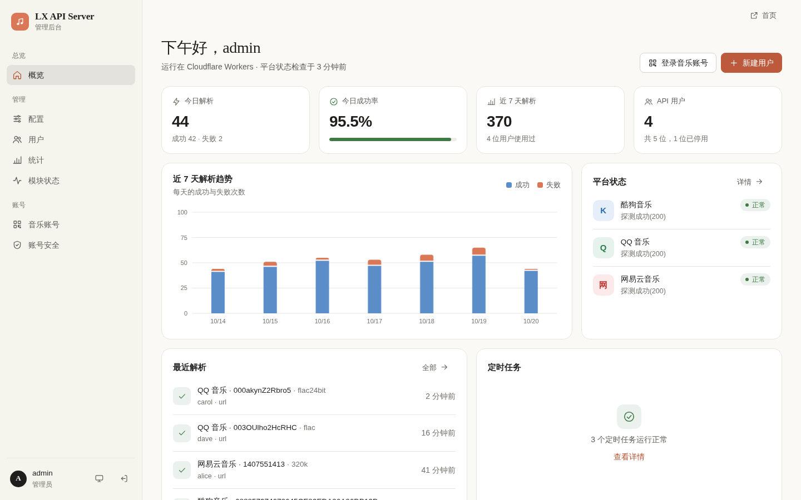
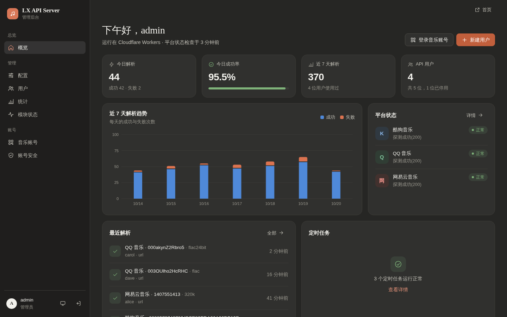
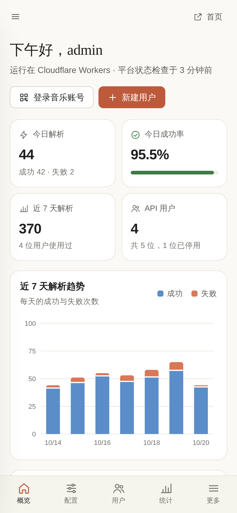
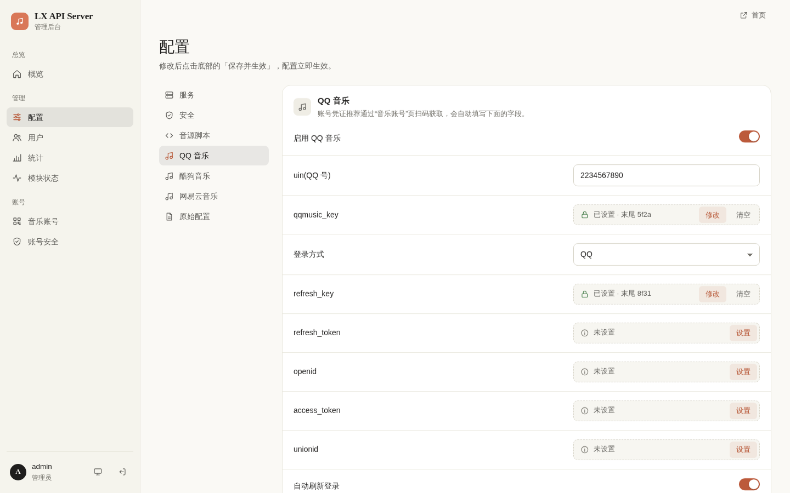
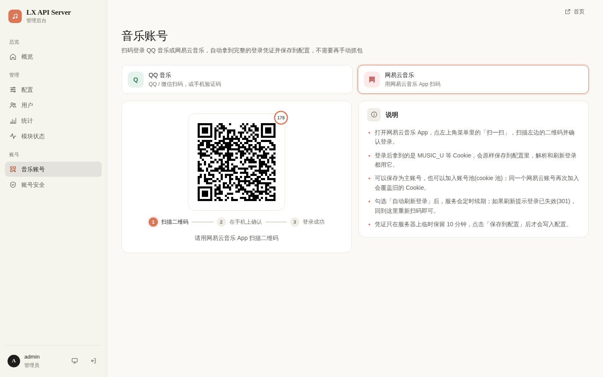

<div align="center">


# LX API Server · Workers 版

**部署在 Cloudflare Workers 上的多平台音乐解析服务，为 [LX Music](https://github.com/lyswhut/lx-music-desktop) 提供自定义音源**

不需要服务器，点一下按钮就能部署到你自己的 Cloudflare 账号

[](https://deploy.workers.cloudflare.com/?url=https://github.com/nanci0406/lx-music-api-server-workers)

[](https://github.com/nanci0406/lx-music-api-server-workers/actions/workflows/ci.yml)


[一键部署](#一键部署) · [接入 LX Music](#接入-lx-music) · [API 文档](#api-文档) · [管理后台](#管理后台) · [其他部署方式](#其他部署方式) · [从旧版升级](#从旧版升级) · [常见问题](#常见问题)

</div>

---

把 QQ 音乐、酷狗音乐、网易云音乐的歌曲解析为可播放的链接，通过“用户名 + Key”提供给 LX Music 使用。自带一个适配电脑和手机的管理后台：扫码登录平台账号、管理用户、查看解析统计、监控账号状态，都在浏览器里完成。

这是 [LX API Server](https://github.com/nanci0406/lx-api-server)(Python 版)的 Cloudflare Workers 实现，接口和管理后台与 Python 版一致。代码运行在 Cloudflare 的边缘网络上，数据保存在 D1 数据库里，免费版的额度对个人使用绰绰有余。

<p align="center">
  
</p>

## 功能特性

**解析**
- QQ 音乐、酷狗音乐、网易云音乐，最高可解析无损、Hi-Res、杜比全景声、母带等音质(视账号权益而定)
- 歌词：QQ 音乐的逐字歌词、翻译和罗马音，酷狗的逐字歌词
- 歌曲信息、MV、酷狗搜索
- 一键生成 LX Music 音源脚本，用户导入一个链接就能用

**账号**
- 后台扫码登录：QQ 音乐支持 QQ 扫码、微信扫码、手机验证码，网易云支持 App 扫码，登录后自动保存
- 自动刷新登录(保活)：凭证按周期自动续期并写回配置；酷狗概念版每日自动签到
- 单账号与账号池两种模式，账号池按请求随机分配账号
- 刷新失败按 1 分钟 → 5 分钟 → 30 分钟 → 2 小时退避重试，后台会标出异常的任务和平台

**管理**
- 七个页面：概览、配置、用户、统计、模块状态、音乐账号、账号安全，配置修改后立即生效
- 适配电脑和手机，支持浅色 / 深色主题，不依赖任何外部 CDN
- 按用户分配 Key，可随时停用、重置；支持全局 / 单 IP 限速、IP 封禁、Host 白名单

**安全**
- 管理员密码加盐哈希存储，登录失败限速，会话空闲 4 小时或登录满 24 小时后过期
- 后台写操作只接受 JSON 请求并校验来源(防 CSRF)，Cookie 为 `HttpOnly` + `SameSite=Strict` + `Secure`，页面启用严格的 CSP
- 日志不记录用户 Key，任何接口都不返回平台凭证

## 界面预览

| 深色模式 | 手机端 |
| :---: | :---: |
|  |  |

| 配置(分组表单、密钥只显示末尾) | 音乐账号(扫码登录) |
| :---: | :---: |
|  |  |

> 截图中的用户、账号和解析记录均为演示数据。

## 一键部署

只需要一个 Cloudflare 账号(免费版即可)和一个 GitHub 账号。

1. 点击下面的按钮，登录 Cloudflare：

   [](https://deploy.workers.cloudflare.com/?url=https://github.com/nanci0406/lx-music-api-server-workers)

2. 按页面提示连接 GitHub(或 GitLab)账号。Cloudflare 会把本项目复制一份到你的账号下，并自动创建 D1 数据库
3. 填写 **`ADMIN_PASSWORD`**：管理后台的登录密码，建议至少 8 位。其余选项保持默认即可
4. 点击部署，等待一两分钟完成
5. 打开 `https://<Worker 名称>.<你的子域>.workers.dev/admin`，用户名 `admin`，密码为第 3 步填写的密码

数据库表结构会在第一次访问时自动创建，不需要额外操作。之后在你自己的那份仓库里修改代码并推送，Cloudflare 会自动重新部署。

> **获取更新**：一键部署复制出来的仓库不会自动同步本项目。需要更新时，把本项目的新代码合并到你的仓库(例如 `git pull https://github.com/nanci0406/lx-music-api-server-workers main` 后推送)，Cloudflare 会自动重新部署，数据库会自动升级。

### 部署后的三步

1. **登录平台账号**：在“音乐账号”页扫码登录 QQ 音乐或网易云音乐，保存时勾选“自动刷新登录”
2. **创建用户**：在“用户”页新建用户，系统会生成一个随机 Key
3. **分发音源**：把音源脚本链接(或用户名和 Key)发给使用者

### 绑定自己的域名(推荐)

`*.workers.dev` 在国内部分网络下访问不稳定。如果你有托管在 Cloudflare 上的域名，可以在 Cloudflare 控制台 → Workers → 你的 Worker → 设置 → 域和路由 里添加自定义域名。音源脚本会自动使用访问时的域名。

## 接入 LX Music

开启“允许下载音源脚本”(默认开启)后，每位用户都有一个专属的音源脚本地址：

```text
https://<你的地址>/script?key=<用户的 Key>
```

在 LX Music 中打开 **设置 → 自定义源 → 在线导入**，粘贴上述地址即可。脚本里已经填好服务地址、用户名和 Key。也可以在后台“用户”页复制脚本链接，或者让用户在公开首页 `/` 输入 Key 自己生成。

脚本名称、版本、更新提示以及各平台开放的音质，在后台“配置 → 音源脚本”中修改；修改后，已导入脚本的客户端会收到更新提示。

## API 文档

### 鉴权

“接口需要用户 Key”开启时(默认开启)，请求头需要带上用户名和 Key：

```http
X-Request-User: alice
X-Request-Key: <用户的 Key>
```

### 接口

| 方法 | 路径 | 说明 |
| --- | --- | --- |
| `GET` | `/url/{source}/{songId}/{quality}` | 获取播放链接 |
| `GET` | `/lyric/{source}/{songId}` | 获取歌词 |
| `GET` | `/info/{source}/{songId}` | 获取歌曲信息 |
| `GET` | `/mv/{source}/{mvId}` | 获取 MV 信息与播放地址 |
| `GET` | `/search/kg/song?query=…&page=1&size=20` | 搜索歌曲(仅酷狗) |
| `GET` | `/script?key=…` | 下载 LX Music 音源脚本 |

| 平台 | `source` | `songId` | url | lyric | info | mv | search |
| --- | --- | --- | :---: | :---: | :---: | :---: | :---: |
| QQ 音乐 | `tx` | songmid | ✓ | ✓ | ✓ | ✓ | |
| 酷狗音乐 | `kg` | hash | ✓ | ✓ | ✓ | ✓ | ✓ |
| 网易云音乐 | `wy` | 歌曲 ID | ✓ | | | | |

### 音质

| `quality` | 说明 | QQ 音乐 | 酷狗 | 网易云 |
| --- | --- | :---: | :---: | :---: |
| `128k` | 标准 | ✓ | ✓ | ✓ |
| `192k` | 较高 | | | ✓ |
| `320k` | 高品质 | ✓ | ✓ | ✓ |
| `flac` | 无损 | ✓ | ✓ | ✓ |
| `flac24bit` | Hi-Res | ✓ | ✓ | ✓ |
| `dolby` | 杜比全景声 | ✓ | | ✓ |
| `sky` | 沉浸环绕声 | | | ✓ |
| `master` | 母带 | ✓ | ✓ | ✓ |

实际能拿到的音质取决于所用账号的会员权益。

### 示例

```bash
curl -H "X-Request-User: alice" \
     -H "X-Request-Key: <用户的 Key>" \
     "https://<你的地址>/url/tx/0039MnYb0qxYhV/320k"
```

```json
{
  "code": 0,
  "msg": "success",
  "data": "https://…",
  "extra": {
    "cache": false,
    "quality": { "target": "320k", "result": "320k" },
    "expire": { "time": 1760000000, "canExpire": true }
  }
}
```

| `code` | 含义 |
| :---: | --- |
| `0` | 成功 |
| `1` | 未知的平台或不支持的方法；IP 已被封禁 |
| `2` | 平台返回获取失败(如无版权、账号无权限)，原因见 `msg` |
| `4` | 平台已在配置中关闭，或服务内部错误 |
| `5` | 触发限速 |
| `6` | 缺少用户名 / Key、Key 验证失败、请求参数错误或资源不存在 |

## 管理后台

后台地址为 `/admin`。

| 页面 | 地址 | 功能 |
| --- | --- | --- |
| 概览 | `/admin` | 今日与近 7 天解析量、成功率、趋势图、平台状态、最近解析、定时任务状态 |
| 配置 | `/admin/config` | 按分组编辑配置并校验；密钥只显示“已设置 / 末尾几位”；“原始配置”可以直接编辑完整的 JSON 配置(含账号池)，保存前自动备份 |
| 用户 | `/admin/users` | 新建、停用、删除用户，重置 Key，复制音源脚本链接，查看每位用户的解析次数与成功率 |
| 统计 | `/admin/stats` | 今天 / 近 7 天 / 近 30 天的趋势、平台分布、用户排行，可筛选的解析记录 |
| 模块状态 | `/admin/health` | 各平台可用性与凭证有效性、定时任务的执行情况；可以立即检查、立即执行任务 |
| 音乐账号 | `/admin/music-login` | 扫码 / 验证码登录 QQ 音乐与网易云音乐，保存为主账号或加入账号池 |
| 账号安全 | `/admin/account` | 修改管理员密码、退出其他设备上的登录 |

公开首页 `/` 展示各平台状态，用户可以用自己的用户名和 Key 在线解析单曲、生成音源脚本链接。首页只显示笼统的状态，账号细节只有管理员能看到。

### 平台账号

**扫码登录(推荐)**：在“音乐账号”页选择平台——QQ 音乐支持 QQ 扫码、微信扫码、手机号 + 短信验证码，网易云使用 App 的“扫一扫”。登录成功后选择保存为主账号或加入账号池，勾选“自动刷新登录”会同时开启保活任务。点击保存之前，凭证只在服务器上临时保留(最长 10 分钟)。

**手动填写**：也可以在“配置”页填写：

| 平台 | 配置项 | 说明 |
| --- | --- | --- |
| QQ 音乐 | `module.tx.user` | `uin`、`qqmusic_key`，以及刷新所需的 `refresh_key`、`refresh_token` 等 |
| 酷狗音乐 | `module.kg.user` | `userid`、`token`、`mid`(抓包 `/v5/url` 请求获得) |
| 网易云音乐 | `module.wy.user.cookie` | 完整 Cookie，需包含 `MUSIC_U` |

**自动刷新登录**：QQ 音乐按保存的 `login_type`(1 微信、2 QQ)选择刷新方式；网易云返回 `301` 表示 `MUSIC_U` 已失效，需要重新扫码；酷狗刷新 `token`，概念版(appid 3116)还支持每日签到。定时任务由 Cron 每分钟触发一次，到期的任务才会执行。

**账号池**：开启“启用账号池”后，每次请求从 `module.cookiepool.<平台>` 中随机选一个账号，单账号配置会被忽略。账号池在“配置 → 原始配置”里编辑，扫码登录时也可以直接加入。

### 常用配置

配置保存在 D1 数据库里，在后台“配置”页修改，保存后立即生效。

| 配置项 | 默认值 | 说明 |
| --- | --- | --- |
| `common.cookiepool` | `false` | 账号池模式 |
| `common.fakeip` | `116.25.146.177` | 请求音乐平台时附带的 `X-Forwarded-For`(Workers 从海外节点发出请求，部分接口需要国内 IP)，留空则不附带 |
| `common.timezone` | `8` | 统计按天分组使用的时区(UTC 偏移小时) |
| `common.allow_download_script` | `true` | 是否开放 `/script` 音源脚本下载 |
| `common.parse_log_retention_days` | `30` | 解析记录保留天数，`0` 为不清理 |
| `security.key.enable` | `true` | 解析接口是否需要用户名和 Key |
| `security.rate_limit.global` / `.ip` | `0` | 全局 / 单 IP 两次请求的最小间隔(秒)，`0` 为不限制 |
| `security.admin_origin_check` | `true` | 后台写操作的来源校验 |
| `module.<平台>.enable` | `true` | 是否启用该平台 |

## 其他部署方式

### 部署脚本

需要 [Node.js](https://nodejs.org/) 20 或更高版本：

```bash
git clone https://github.com/nanci0406/lx-music-api-server-workers.git
cd lx-music-api-server-workers
./deploy.sh        # Windows 运行 deploy.bat
```

脚本会安装依赖、登录 Cloudflare、创建 D1 数据库(放在亚太地区)、初始化表结构并部署，最后询问管理员密码。升级时拉取新代码后再运行一次即可。

### 手动部署

```bash
npm install
npx wrangler login

# 创建数据库，把输出的 database_id 填到 wrangler.toml
npx wrangler d1 create lx-music-api-db --location apac

# 设置管理员密码(用户名默认 admin，见 wrangler.toml 的 ADMIN_USERNAME)
npx wrangler secret put ADMIN_PASSWORD

npm run deploy
```

Cloudflare 账号下有多个账户时，设置环境变量 `CLOUDFLARE_ACCOUNT_ID` 指定部署到哪一个。

### 管理员账号

- `ADMIN_PASSWORD`(一键部署时填写，或用 `wrangler secret put` 设置)只在数据库里还没有管理员时生效，用户名为 `ADMIN_USERNAME`(默认 `admin`)
- 两者都没有设置时，第一次打开 `/admin` 会提示创建管理员。**请部署后立即创建**，在此之前任何人打开后台都可以创建
- 登录后可以在“账号安全”页修改密码

## 从旧版升级

旧版 Workers(多音源 kg / kw / tx / wy / mg 的版本)升级到本版本：

- **配置自动迁移**：旧版 `source_configs` / `system_settings` 表里的账号凭证、鉴权开关、限速设置会在第一次启动时读入新配置，旧表保留不动
- **数据保留**：管理员(旧版的 sha256 密码登录后自动升级为加盐哈希)、用户、解析记录都保留
- **酷我、咪咕已下线**(与 Python 版一致)，音源脚本里也不再包含它们
- **不再使用 KV**：免费版 KV 每天只有 1000 次写入，旧版每次解析都会写 KV。`wrangler.toml` 已去掉 KV 绑定，旧的 KV 命名空间可以在控制台删除
- **`wrangler.toml` 不再写 `account_id`**，部署时使用 wrangler 登录的账号
- 旧的测试接口 `/test/*` 和 `/health` 已移除，平台状态请看后台“模块状态”页

拉取新代码后运行 `./deploy.sh`(或 `npm install && npm run deploy`)即可，数据库表结构会自动升级。

## 与 Python 版的差异

| | Python 版 | Workers 版 |
| --- | --- | --- |
| 部署 | 自己的服务器 | Cloudflare Workers + D1，一键部署 |
| 配置 | `config/config.yml`，原始配置为 YAML | D1，原始配置为 JSON |
| 定时任务 | 进程内调度 | Cron 每分钟触发 |
| 管理员密码 | 首次启动随机生成并打印在日志里 | `ADMIN_PASSWORD`，或首次打开后台时创建 |
| QQ 音乐逐字歌词 | 需要 qdes 原生库 | 内置 QRC 解密，始终可用 |
| 没有的功能 | — | 服务器本地音乐、出站代理、监听地址 / 端口 / HTTPS 证书等(由 Cloudflare 负责) |

## 安全建议

- 部署时设置 `ADMIN_PASSWORD`，或部署后立即创建管理员；密码至少 8 位
- 保持“接口需要用户 Key”开启
- D1 里保存着账号凭证和用户 Key，不要把数据库导出文件分享给别人
- 用户 Key 等同于账号密码，泄露后请在“用户”页重置
- 后台“原始配置”页会显示全部凭证明文，请勿截图外传

## 常见问题

<details>
<summary><b>一键部署时要填哪些内容</b></summary>

只需要填 `ADMIN_PASSWORD`(管理后台密码)。Worker 名称、数据库名称等保持默认即可；如果改了 Worker 名称，访问地址也会跟着变。
</details>

<details>
<summary><b>打开后台提示创建管理员</b></summary>

数据库里还没有管理员，也没有设置 `ADMIN_PASSWORD`。直接在页面上创建即可，创建后这个页面就不能再使用了。
</details>

<details>
<summary><b>忘记管理员密码</b></summary>

在 Cloudflare 控制台 → D1 → 数据库 → 控制台里执行 `DELETE FROM admins;`，然后重新设置 `ADMIN_PASSWORD`(或打开 `/admin` 重新创建)。用户和配置不受影响。
</details>

<details>
<summary><b>酷狗：提示“本次请求需要验证”(20028)或“签名错误”(20006)</b></summary>

- **20028**：酷狗不认可当前的伪装 IP。默认的 `116.25.146.177` 可以正常使用；如果仍然出现，在“配置 → 服务”里换一个国内 IP
- **20006**：客户端类型和账号不匹配。**概念版**的 token 需要把“配置 → 酷狗音乐 → 客户端类型”设为 `3116`，签名 key、`pidversionsecret`、`pid` 会自动切换成概念版的值；普通版的 token 用 `1005`
- 刷新登录提示 **20017**：token 已经失效，需要重新抓包获取
</details>

<details>
<summary><b>QQ 扫码后提示“获取登录凭据失败：没有拿到 p_skey”</b></summary>

提示末尾附有每次请求的状态码和跳转去向，例如 `(HTTP 302，跳转到 …)`，可以据此判断是否是 QQ 要求了额外的安全验证。也可以改用手机验证码登录。
</details>

<details>
<summary><b>网易云刷新登录提示 code 301</b></summary>

`MUSIC_U` 已经失效，刷新无法恢复。请在“音乐账号”页重新扫码登录。
</details>

<details>
<summary><b>部分歌曲解析失败</b></summary>

先确认账号有对应的会员权益。Workers 从海外节点发出请求，部分平台会限制海外 IP：服务默认附带 `X-Forwarded-For` 伪装国内 IP(`common.fakeip`)，如果某个平台仍然失败，可以尝试更换这个地址。
</details>

<details>
<summary><b>后台保存时提示“请求来源校验失败”</b></summary>

通常是在 Worker 前面又套了一层代理并改写了 `Host`。请让代理透传原始 `Host`(或设置 `X-Forwarded-Host`)，或者在配置中关闭“后台请求来源校验”。
</details>

<details>
<summary><b>免费版的额度够用吗</b></summary>

一次解析是 1 次 Worker 请求，D1 读取几行、写入 5～8 行(解析记录及其索引、缓存；用户的最近使用时间每分钟最多更新一次)。免费版每天 10 万次请求、500 万行读取、10 万行写入，大约够每天一万多次解析，个人和小范围使用足够。
</details>

## 开发

```text
lx-music-api-server-workers
├── src/
│   ├── index.ts          # 入口：fetch 与 scheduled
│   ├── app.ts            # 全局中间件(封禁、限速、Host 白名单)与路由
│   ├── cron.ts           # Cron：定时任务、平台状态检查、清理
│   ├── config/           # 默认配置、配置读写(D1)
│   ├── routes/           # 解析接口、后台接口、首页接口、页面
│   ├── services/         # 用户、统计、鉴权、定时任务、平台状态、扫码会话等
│   ├── sources/          # 各平台实现：tx(QQ 音乐)、kg(酷狗)、wy(网易云)
│   ├── webui/            # 后台配置页的字段定义与校验
│   ├── script/           # LX Music 音源脚本模板
│   └── db/schema.sql     # 表结构
├── public/static/        # 管理后台与首页的前端
├── test/                 # 测试(用 node:sqlite 模拟 D1，不访问真实网络)
└── docs/images/          # README 截图
```

```bash
cp .dev.vars.example .dev.vars   # 本地开发的管理员密码
npm run dev                      # 本地运行(使用本地 D1)
npm run typecheck                # 类型检查
npm test                         # 运行测试(需要 Node.js 22.5 以上)
```

`npm run dev` 之后，访问 `http://127.0.0.1:8787/__scheduled?cron=*+*+*+*+*` 可以手动触发一次定时任务(需要加 `--test-scheduled` 参数)。每次推送和 Pull Request 都会通过 GitHub Actions 运行类型检查、测试和打包检查。

## 致谢

- [LX API Server](https://github.com/nanci0406/lx-api-server)：Python 版，本项目的功能与接口以它为准
- [lx-music-api-server](https://github.com/MeoProject/lx-music-api-server)：解析服务的上游项目，QIMEI 与设备信息的实现也参考了该项目
- [YAQMC/qm-api-rs](https://github.com/YAQMC/qm-api-rs)、[qqmusic-api-python](https://github.com/l-1124/QQMusicApi)：QQ 音乐登录协议参考
- [NeteaseCloudMusicApi](https://www.npmjs.com/package/NeteaseCloudMusicApi)：网易云音乐扫码登录与刷新登录参考
- [LX Music](https://github.com/lyswhut/lx-music-desktop)：优秀的开源音乐播放器

## 免责声明

本项目仅供学习与技术交流使用，请勿用于商业用途。通过本项目获取的音乐内容，版权归各音乐平台及版权方所有，请在合理范围内使用，并支持正版音乐。使用本项目产生的一切后果由使用者自行承担。

## 许可证

[MIT](https://opensource.org/licenses/MIT)
